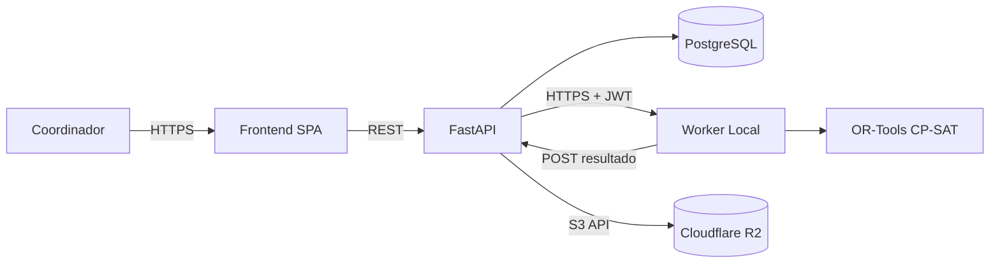

# 01 — Arquitectura Detallada

## Visión

Arquitectura híbrida desacoplada (*Heavy Compute Delegation*): VPS (datos + web) y Worker local (optimización CP-SAT). El VPS nunca ejecuta el solver.

## Componentes

- **Frontend Web**: Next.js 14 (App Router) + TypeScript + Tailwind/shadcn. Consume API REST.
- **Backend API**: FastAPI (Python 3.11), async, Uvicorn. ORM SQLAlchemy 2.0 + Alembic.
- **Base de Datos**: PostgreSQL 16.
- **Worker Local**: Python 3.11, polling REST, Google OR-Tools CP-SAT. Ejecuta en PC del coordinador.
- **Almacenamiento de objetos**: Cloudflare R2 (S3-compatible) para fotos de perfil y adjuntos. El VPS no guarda archivos binarios.
- **Proxy/SSL**: Nginx + Let's Encrypt (configuración manual, sin contenedores).

## Diagrama lógico

## Flujos principales

1. **Gestión de datos**: tutor registra disponibilidad y materias → API persiste.
2. **Solicitud de corrida**: coordinador define grupos/sede → API crea `corridas_horarios` estado `PENDIENTE`, calcula `config_hash`.
3. **Caché**: si hash existe con estado `COMPLETADO`, retorna resultado sin Worker.
4. **Procesamiento**: Worker hace polling, toma tarea `PENDIENTE`, resuelve, publica resultado `COMPLETADO`/`ERROR`.
5. **Consulta**: Frontend consulta estado y muestra propuesta + métricas.

## Módulo de inscripción anual

El registro anual corre dentro del mismo backend y comparte base de datos,
autenticación y roles:

- **Aspirante (web)**: `POST /auth/register` crea usuario + perfil, genera
  folio/matrícula y deja el evento `registro` en la bitácora.
- **Padrón**: `students` con `anio` como cohorte; los listados filtran por año,
  sede y estatus, con búsqueda por matrícula, correo o teléfono.
- **Mesa presencial**: check-in por matrícula o QR → evento `checkin`.
- **Pagos**: cargos (`simulacro`) y pagos (`efectivo` en sede,
  `transferencia` validada a mano); comprobantes en bucket privado de R2.
- **Notificaciones**: outbox en base de datos, enviado por el Worker
  (`POST /worker/notificaciones`) o desde la API con
  `POST /notificaciones/procesar`.
- **Cierre de ciclo**: `scripts/reset_academic_year.py` adelanta el año activo
  y cierra el registro sin borrar el histórico
  (ver `10-cierre-anual.md`).

## Comunicación VPS ↔ Worker

- Protocolo: HTTPS REST, autenticación por API key (header `X-Worker-Key`) + JWT de corta vida opcional.
- Polling cada 5s (configurable). Timeout de tarea: 30 min.
- Payloads JSON, ver `04-protocolo-worker.md`.

## Escalabilidad

- VPS stateless; escalado horizontal detrás de proxy.
- Worker único por coordinador (evita contención); múltiples Workers posibles con locking por tarea (`SELECT ... FOR UPDATE SKIP LOCKED`).
- PostgreSQL con connection pooling (PgBouncer opcional).

## Almacenamiento de resultados

- `resultado_json` y `metricas_optimizacion` en JSONB.
- Archivos grandes (si aplica) en volumen Docker; DB guarda referencia.
