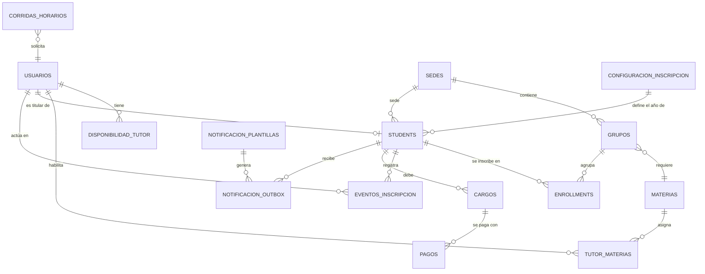

# 02 — Modelo de Datos

## ERD (Mermaid)

## Tablas

### usuarios
| Col | Tipo | Constraints |
|-----|------|-------------|
| id | SERIAL | PK |
| nombre | VARCHAR(100) | NOT NULL |
| apellido_paterno | VARCHAR(100) | NOT NULL |
| apellido_materno | VARCHAR(100) | |
| email | VARCHAR(100) | UNIQUE NOT NULL |
| password_hash | VARCHAR(255) | NOT NULL |
| rol | VARCHAR(20) | NOT NULL — admin, coordinador, subcoordinador, tutor, inscripcion, alumno |
| es_tutor | BOOLEAN | NOT NULL DEFAULT FALSE |
| telefono | VARCHAR(30) | |
| biografia_md | TEXT | (markdown) |
| foto_url | VARCHAR(500) | URL en R2 |
| carga_max_horas | INT | DEFAULT 0 |
| area_principal | VARCHAR(50) | |
| creado_en | TIMESTAMPTZ | DEFAULT NOW() |
| actualizado_en | TIMESTAMPTZ | DEFAULT NOW() |

> Un coordinador con `es_tutor=TRUE` puede registrar disponibilidad y materias habilitadas, y recibir asignaciones como cualquier tutor.

### materias
| Col | Tipo / Constraint |
|---|---|
| id | SERIAL PK |
| nombre | VARCHAR(100) NOT NULL |
| nivel | VARCHAR(20) NOT NULL CHECK IN ('PREPA','LICENCIATURA') |
| area | VARCHAR(50) NOT NULL |
| horas_bloque | INT NOT NULL DEFAULT 2 |
| frecuencia_semanal | INT NOT NULL DEFAULT 1 |

### disponibilidad_tutor
| Col | Tipo / Constraint |
|---|---|
| id | SERIAL PK |
| tutor_id | INT FK usuarios(id) ON DELETE CASCADE |
| dia_semana | INT NOT NULL CHECK BETWEEN 1 AND 6 |
| hora_inicio | TIME NOT NULL CHECK (hora_fin > hora_inicio) |
| hora_fin | TIME NOT NULL CHECK (hora_fin > hora_inicio) |

### tutor_materias
| Col | Tipo / Constraint |
|---|---|
| tutor_id | INT FK |
| materia_id | INT FK |
| nivel_preferencia | INT DEFAULT 1 CHECK BETWEEN 1 AND 3 |
| PK (tutor_id, materia_id) |

### sedes
| Col | Tipo / Constraint |
|---|---|
| id | SERIAL PK |
| nombre | VARCHAR(100) NOT NULL |
| ciudad | VARCHAR(100) |

### grupos
| Col | Tipo / Constraint |
|---|---|
| id | SERIAL PK |
| sede_id | INT FK sedes |
| materia_id | INT FK materias |
| nombre | VARCHAR(50) NOT NULL |
| capacidad | INT DEFAULT 30 |
| horas_totales | INT NOT NULL |

### corridas_horarios
| Col | Tipo / Constraint |
|---|---|
| id | SERIAL PK |
| config_hash | VARCHAR(64) NOT NULL |
| estado | VARCHAR(20) NOT NULL DEFAULT 'PENDIENTE' CHECK IN ('PENDIENTE','PROCESANDO','COMPLETADO','ERROR') |
| solicitado_por | VARCHAR(100) |
| sede_id | INT FK sedes |
| parametros_resumen | JSONB |
| resultado_json | JSONB |
| metricas_optimizacion | JSONB |
| intentos | INT DEFAULT 0 |
| error_detalle | TEXT |
| creado_en | TIMESTAMPTZ DEFAULT NOW() |
| actualizado_en | TIMESTAMPTZ DEFAULT NOW() |

## Almacenamiento de objetos (Cloudflare R2)

No se almacenan archivos binarios en PostgreSQL. La DB guarda únicamente URLs públicas/firmadas.

### archivos
| Col | Tipo | Constraints |
|-----|------|-------------|
| id | SERIAL | PK |
| owner_id | INT FK usuarios | ON DELETE CASCADE |
| tipo | VARCHAR(30) | NOT NULL CHECK IN ('foto_perfil','biografia_adjunto') |
| key_r2 | VARCHAR(500) | NOT NULL UNIQUE |
| url_publica | VARCHAR(500) | |
| mime_type | VARCHAR(100) | |
| tamano_bytes | BIGINT | |
| creado_en | TIMESTAMPTZ | DEFAULT NOW() |

Reglas:
- Bucket R2 privado por defecto; fotos de perfil con URL pública opcional.
- Claves con prefijo `{tipo}/{user_id}/{uuid}.{ext}`.
- Límite de tamaño: 5 MB fotos, 2 MB adjuntos.

- `idx_corridas_hash` ON corridas_horarios(config_hash)
- `idx_corridas_estado` ON corridas_horarios(estado)
- `idx_disponibilidad_tutor` ON disponibilidad_tutor(tutor_id, dia_semana)
- `idx_grupos_sede` ON grupos(sede_id)

## Migraciones

- Alembic con revisiones versionadas en `backend/alembic/versions/`.
- Seeds: `seeds/load.py` (base), `seeds/seed_demo.py` (catálogo y tutores demo) y
  `seeds/seed_aspirantes_demo.py` (50 aspirantes tomados del formulario real,
  sólo para staging/local).

## Reglas de integridad

- Un tutor no puede tener disponibilidades solapadas (validar en app).
- `config_hash` calculado sobre JSON canónico ordenado de entradas inmutables.

## Estudiantes e inscripciones

### students
| Col | Tipo / Constraint |
|---|---|
| id | SERIAL PK |
| user_id | INT FK usuarios UNIQUE (nullable para importados) |
| sede_id | INT FK sedes (nullable) |
| nivel | VARCHAR(20) NOT NULL CHECK IN ('PREPA','LICENCIATURA') |
| area | VARCHAR(80) |
| estatus | VARCHAR(20) DEFAULT 'registrado' CHECK IN ('registrado','en_inscripcion','inscrito','activo','no_asistio','cancelado','baja') |
| anio | INT NOT NULL — cohorte del proceso de inscripción |
| registration_source | VARCHAR(20) DEFAULT 'web' CHECK IN ('web','presencial','importacion','seed') |
| phone_normalized | VARCHAR(15) UNIQUE parcial (solo `deleted_at IS NULL`) |
| qr_token | VARCHAR(64) UNIQUE — token del pase y QR |
| checkin_at / checkin_by / checkin_sede_id | Confirmación presencial |
| folio / matricula | UNIQUE, inmutables |
| creado_en | TIMESTAMPTZ DEFAULT NOW() |
| actualizado_en | TIMESTAMPTZ DEFAULT NOW() |
| deleted_at | TIMESTAMPTZ — borrado lógico |

Índices relevantes: `ix_students_anio_estatus`, `ix_students_sede_estatus`,
`ix_students_area`, `uq_students_email_lower`, `uq_students_phone_normalized`,
`uq_students_qr_token`, y GIN trigram sobre `full_name`, `matricula` y `email`.

### configuracion_inscripcion (singleton `id = 1`)
| Col | Tipo / Constraint |
|---|---|
| anio | INT NOT NULL CHECK BETWEEN 2000 AND 2100 — año activo del proceso |
| registro_abierto | BOOLEAN NOT NULL DEFAULT TRUE |
| simulacro_activo | BOOLEAN NOT NULL DEFAULT TRUE |
| simulacro_monto | NUMERIC(10,2) NOT NULL DEFAULT 150.00 CHECK >= 0 |
| simulacro_moneda | VARCHAR(10) NOT NULL DEFAULT 'MXN' |
| pago_efectivo_habilitado | BOOLEAN NOT NULL DEFAULT TRUE |
| transferencia_habilitada | BOOLEAN NOT NULL DEFAULT FALSE |
| transferencia_banco / transferencia_titular / transferencia_clabe / transferencia_instrucciones | Datos del banco para comprobantes |
| parcialidades_permitidas / parcialidades_max | BOOLEAN / INT CHECK >= 1 |
| donativo_obligatorio / donativo_descripcion | Presentación del donativo |
| updated_by | INT FK usuarios (último admin que ajustó la configuración) |
| creado_en / actualizado_en | TIMESTAMPTZ DEFAULT NOW() |

El año activo se cambia con `backend/scripts/reset_academic_year.py`
(ver [10 — Cierre y Apertura Anual](10-cierre-anual.md)); el cierre no borra
histórico, sólo avanza `anio` y deja el registro cerrado.

### eventos_inscripcion (bitácora)
| Col | Tipo / Constraint |
|---|---|
| id | SERIAL PK |
| student_id | INT FK students ON DELETE CASCADE |
| tipo | VARCHAR(30) CHECK IN ('registro','checkin','cambio_estatus','pago_efectivo','pago_comprobante','pago_validado','pago_rechazado','pase_generado','notificacion','importacion') |
| estado_anterior / estado_nuevo | VARCHAR(20) |
| actor_id | INT FK usuarios (staff que ejecutó la acción) |
| sede_id | INT FK sedes |
| metadata | JSONB — contexto (origen del registro, método de pago, detalle) |
| creado_en | TIMESTAMPTZ DEFAULT NOW() |

### cargos
| Col | Tipo / Constraint |
|---|---|
| id | SERIAL PK |
| student_id | INT FK students ON DELETE CASCADE |
| anio | INT NOT NULL — cohorte del cargo |
| concepto | VARCHAR(60) — `simulacro` en el flujo actual |
| descripcion | VARCHAR(255) |
| monto / moneda | NUMERIC(10,2) / VARCHAR(10) |
| estado | VARCHAR(20) CHECK IN ('pendiente','parcial','pagado','cancelado','exento') |
| UNIQUE | (student_id, anio, concepto) — un cargo por alumno y año |

### pagos
| Col | Tipo / Constraint |
|---|---|
| id | SERIAL PK |
| student_id | INT FK students ON DELETE CASCADE |
| cargo_id | INT FK cargos ON DELETE CASCADE |
| monto / moneda | NUMERIC(10,2) / VARCHAR(10) |
| metodo | VARCHAR(20) — `efectivo` o `transferencia` |
| estado | VARCHAR(20) CHECK IN ('pendiente','validado','rechazado','cancelado') |
| comprobante_key / comprobante_url | Referencia privada en R2 (opcional) |
| validado_por / validado_at | Staff que validó la transferencia |
| referencia | TEXT — folio o nota del comprobante |
| creado_en | TIMESTAMPTZ DEFAULT NOW() |

Reglas de negocio:
- El simulacro es **opt-in**: sólo genera cargo si el aspirante lo acepta.
- El cargo de simulacro no bloquea la inscripción.
- Las transferencias se validan manualmente; el efectivo se captura en sede.
- Un alumno tiene como máximo un cargo `simulacro` por año.

### notificacion_plantillas / notificacion_outbox
| notificacion_plantillas | notificacion_outbox |
|---|---|
| clave (UNIQUE), nombre, asunto, cuerpo_texto, cuerpo_html, variables JSONB, activo | plantilla_clave, destinatario_email, asunto, cuerpo, contexto JSONB, dedupe_key (UNIQUE parcial), estado (`pendiente`,`enviado`,`error`,`cancelado`), intentos, programado_para, enviado_at, ultimo_error |

Plantillas iniciales sembradas por la migración `e4f5a6b7c8d9`:
`registro_confirmado`, `pase_inscripcion`, `recordatorio_inscripcion_presencial`,
`checkin_confirmado`, `simulacro_confirmado`, `pago_recibido`, `pago_validado`,
`pago_rechazado`, `credencial_lista`.

### enrollments
| Col | Tipo / Constraint |
|---|---|
| id | SERIAL PK |
| student_id | INT FK students |
| grupo_id | INT FK grupos |
| estado | VARCHAR(20) DEFAULT 'confirmada' CHECK IN ('confirmada','pendiente_pago','cancelada','lista_espera') |
| payment_status | VARCHAR(20) DEFAULT 'no_requerido' |
| creado_en | TIMESTAMPTZ DEFAULT NOW() |
| actualizado_en | TIMESTAMPTZ DEFAULT NOW() |

### Configuración de inscripción por sede
Los campos `waitlist_enabled`, `payment_enabled`, `payment_amount` y `payment_currency` en `sedes` controlan lista de espera y pago manual.
El proceso de inscripción anual (simulacro, efectivo, transferencias, parcialidades) se configura de forma global en `configuracion_inscripcion`, descrita más arriba.

### Grupos
`grupos.min_alumnos` permite definir un mínimo para abrir un grupo en corridas (configurable, por defecto 0).

## Sedes y matrícula

### sedes (campos adicionales)
| Col | Tipo / Constraint |
|---|---|
| codigo | VARCHAR(1) UNIQUE |

### students — campos del formulario de inscripción
Además de las columnas de la tabla `students` descrita arriba, el perfil del
aspirante incluye:
`first_name`, `paternal_last_name`, `maternal_last_name`, `full_name`, `email`, `preferred_sede_id`, `municipality_state`, `colony`, `address`, `phone`, `emergency_contact_raw`, `emergency_contact_name`, `emergency_contact_phone`, `high_school_type`, `exam_attempts`, `desired_degree`, `study_area`, `diagnostic_exam`, `donation_willingness`, `presencial_consent`, `credential_collected`, `preferred_course_location`, `photo_url`, `folio`, `matricula`, `form_submitted_at`, `notes`.

`user_id` y `sede_id` son nullable para aspirantes importados sin cuenta o sin sede asignada.

### Regla de matrícula
Formato: `{codigo_sede}{P|L}{folio:04d}{iniciales}`.
- `P` = Prepa, `L` = Licenciatura.
- Folio global de 4 dígitos, tomado de la secuencia `student_folio_seq`
  (`SELECT nextval('student_folio_seq')`). El folio **no** se reinicia cada año.
- Iniciales: primer carácter del nombre, apellido paterno y apellido materno.
- Si falta apellido materno, la tercera inicial es `X`.
- La matrícula es única y no editable.
- La sede debe tener `codigo` de un carácter; sin código no se genera matrícula.
