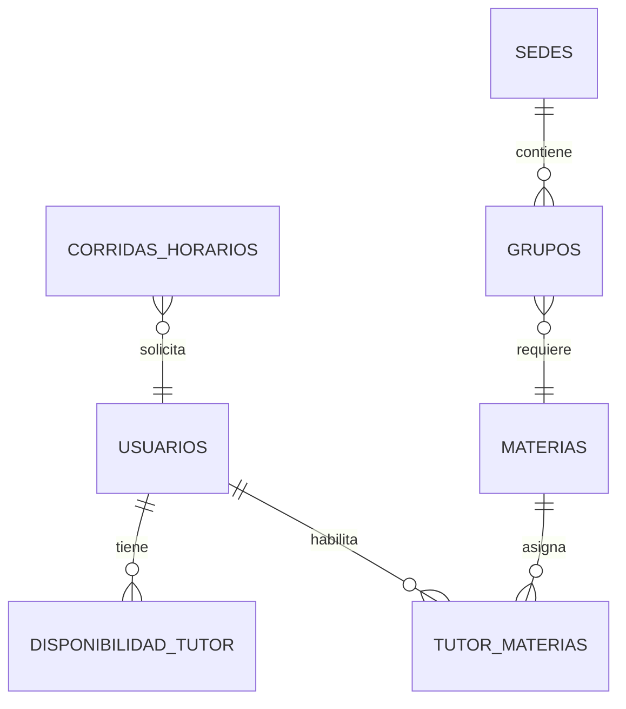

# 02 — Modelo de Datos

## ERD (Mermaid)

## Tablas

### usuarios
| Col | Tipo | Constraints |
|-----|------|-------------|
| id | SERIAL | PK |
| nombre | VARCHAR(100) | NOT NULL |
| apellido_paterno | VARCHAR(100) | NOT NULL |
| apellido_materno | VARCHAR(100) | |
| email | VARCHAR(100) | UNIQUE NOT NULL |
| password_hash | VARCHAR(255) | NOT NULL |
| rol | VARCHAR(20) | NOT NULL CHECK IN ('admin','coordinador','tutor') |
| es_tutor | BOOLEAN | NOT NULL DEFAULT FALSE |
| telefono | VARCHAR(30) | |
| biografia_md | TEXT | (markdown) |
| foto_url | VARCHAR(500) | URL en R2 |
| carga_max_horas | INT | DEFAULT 0 |
| area_principal | VARCHAR(50) | |
| creado_en | TIMESTAMPTZ | DEFAULT NOW() |
| actualizado_en | TIMESTAMPTZ | DEFAULT NOW() |

> Un coordinador con `es_tutor=TRUE` puede registrar disponibilidad y materias habilitadas, y recibir asignaciones como cualquier tutor.

### materias
| Col | Tipo / Constraint |
|---|---|
| id | SERIAL PK |
| nombre | VARCHAR(100) NOT NULL |
| nivel | VARCHAR(20) NOT NULL CHECK IN ('PREPA','LICENCIATURA') |
| area | VARCHAR(50) NOT NULL |
| horas_bloque | INT NOT NULL DEFAULT 2 |
| frecuencia_semanal | INT NOT NULL DEFAULT 1 |

### disponibilidad_tutor
| Col | Tipo / Constraint |
|---|---|
| id | SERIAL PK |
| tutor_id | INT FK usuarios(id) ON DELETE CASCADE |
| dia_semana | INT NOT NULL CHECK BETWEEN 1 AND 6 |
| hora_inicio | TIME NOT NULL CHECK (hora_fin > hora_inicio) |
| hora_fin | TIME NOT NULL CHECK (hora_fin > hora_inicio) |

### tutor_materias
| Col | Tipo / Constraint |
|---|---|
| tutor_id | INT FK |
| materia_id | INT FK |
| nivel_preferencia | INT DEFAULT 1 CHECK BETWEEN 1 AND 3 |
| PK (tutor_id, materia_id) |

### sedes
| Col | Tipo / Constraint |
|---|---|
| id | SERIAL PK |
| nombre | VARCHAR(100) NOT NULL |
| ciudad | VARCHAR(100) |

### grupos
| Col | Tipo / Constraint |
|---|---|
| id | SERIAL PK |
| sede_id | INT FK sedes |
| materia_id | INT FK materias |
| nombre | VARCHAR(50) NOT NULL |
| capacidad | INT DEFAULT 30 |
| horas_totales | INT NOT NULL |

### corridas_horarios
| Col | Tipo / Constraint |
|---|---|
| id | SERIAL PK |
| config_hash | VARCHAR(64) NOT NULL |
| estado | VARCHAR(20) NOT NULL DEFAULT 'PENDIENTE' CHECK IN ('PENDIENTE','PROCESANDO','COMPLETADO','ERROR') |
| solicitado_por | VARCHAR(100) |
| sede_id | INT FK sedes |
| parametros_resumen | JSONB |
| resultado_json | JSONB |
| metricas_optimizacion | JSONB |
| intentos | INT DEFAULT 0 |
| error_detalle | TEXT |
| creado_en | TIMESTAMPTZ DEFAULT NOW() |
| actualizado_en | TIMESTAMPTZ DEFAULT NOW() |

## Almacenamiento de objetos (Cloudflare R2)

No se almacenan archivos binarios en PostgreSQL. La DB guarda únicamente URLs públicas/firmadas.

### archivos
| Col | Tipo | Constraints |
|-----|------|-------------|
| id | SERIAL | PK |
| owner_id | INT FK usuarios | ON DELETE CASCADE |
| tipo | VARCHAR(30) | NOT NULL CHECK IN ('foto_perfil','biografia_adjunto') |
| key_r2 | VARCHAR(500) | NOT NULL UNIQUE |
| url_publica | VARCHAR(500) | |
| mime_type | VARCHAR(100) | |
| tamano_bytes | BIGINT | |
| creado_en | TIMESTAMPTZ | DEFAULT NOW() |

Reglas:
- Bucket R2 privado por defecto; fotos de perfil con URL pública opcional.
- Claves con prefijo `{tipo}/{user_id}/{uuid}.{ext}`.
- Límite de tamaño: 5 MB fotos, 2 MB adjuntos.

- `idx_corridas_hash` ON corridas_horarios(config_hash)
- `idx_corridas_estado` ON corridas_horarios(estado)
- `idx_disponibilidad_tutor` ON disponibilidad_tutor(tutor_id, dia_semana)
- `idx_grupos_sede` ON grupos(sede_id)

## Migraciones

- Alembic con revisiones versionadas en `backend/alembic/versions/`.
- Seeds: materias BUAP prepa/licenciatura en `seeds/materias.sql`.

## Reglas de integridad

- Un tutor no puede tener disponibilidades solapadas (validar en app).
- `config_hash` calculado sobre JSON canónico ordenado de entradas inmutables.
